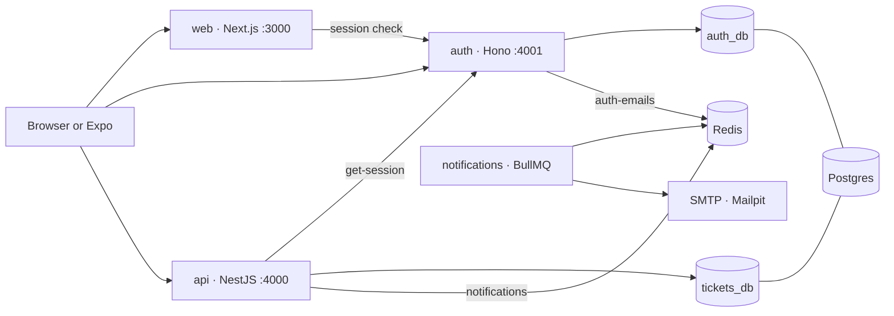

# Trackbit

Trackbit is a small issue tracker: projects, a backlog, a kanban board, and comments, with email when work changes. It is also a worked example of splitting one product into services that each own a job — identity, domain data, and side effects — and running them together with Docker Compose.

A signed-in user creates a project with a short key such as `WEB`. Tickets in that project get stable ids (`WEB-1`, `WEB-12`), a status, a priority, optional story points, and a due date. Dragging a card on the board updates its status. Comments and new tickets enqueue mail; a separate worker sends it.

## What it does

- Sign up, sign in, and reset a password with email and password
- Create, update, archive, and delete projects
- Track tickets through `BACKLOG`, `TODO`, `IN_PROGRESS`, and `DONE`
- Set priority (`LOW` through `URGENT`), Fibonacci story points, and a due date
- Search, sort, and page a project's tickets
- Move work on a drag-and-drop board, and keep a backlog beside it
- Comment on a ticket
- Email the owner when a ticket is created, a comment is added, or a password reset is requested

An Expo client in `apps/mobile` signs in against the same auth service and lists projects. It is a thin companion app, not part of the Compose stack.

## Architecture

Four application processes share Postgres and Redis. The browser talks to three of them. The notifications process has no HTTP port; it only consumes queues.



One Postgres instance holds two databases, created at first boot by `infra/postgres/init`. `auth_db` stores users, sessions, and credentials. `tickets_db` stores projects, tickets, and comments, and keeps the user id as a string. The API never joins across those databases. When it needs a name or email, it reads them from the session the auth service already validated.

### Request path

Creating a ticket shows how the pieces meet:

1. The Next.js proxy asks auth whether the session cookie is still valid. Public pages (landing, sign-in, sign-up, password reset) skip that check. A signed-in visitor hitting `/signin` is sent to `/projects`. If auth cannot be reached, the proxy treats the visitor as signed out.
2. The browser posts to the API with the same cookie (`withCredentials`).
3. A global NestJS guard forwards that cookie to `GET /api/auth/get-session` and attaches `{ id, email, name }` to the request. Routes opt out with a `@Public()` decorator. Health checks are public; everything else is not.
4. A Zod pipe validates and strips the body at the controller. Unknown fields are dropped. Story points must be one of `1, 2, 3, 5, 8, 13`.
5. Inside one transaction the API increments `Project.ticketCounter` and inserts the ticket with that number, so `WEB-12` cannot be issued twice.
6. The API enqueues a `ticket.created` job and returns the ticket. If Redis is down, the error is logged and the request still succeeds: the ticket is already saved.
7. The worker renders the email and sends it over SMTP. Failed jobs retry with exponential backoff.

Password reset follows the same queue, on a separate `auth-emails` channel. The auth handler does not wait for the enqueue, so response time does not reveal whether an email has an account. Jobs that fail keep the reset link for a limited time, then Redis drops them.

### Boundaries

| Service | Owns | Talks to |
| --- | --- | --- |
| `web` | UI, route protection, client cache | Auth for the session; API for projects, tickets, and comments |
| `auth` | Sign-up, sessions, password reset | `auth_db`; the `auth-emails` queue |
| `api` | Projects, tickets, comments | `tickets_db`; auth for every protected request; the `notifications` queue |
| `notifications` | Delivering mail | Redis; SMTP |

The web and API both call auth. The web check keeps anonymous users off project pages. The API check is the real authorization boundary: a stolen page render cannot read another user's tickets. Project lists are filtered by `createdById`. A ticket or comment owned by someone else is returned as not found, so the response does not confirm that the id exists. A project's key cannot be edited after creation, because ticket ids such as `WEB-12` are derived from it.

Job payloads are declared in each service on purpose. There is no shared package between `api`, `auth`, and `notifications`, so a change to one image does not force a lockstep release of the others. New fields on a job are optional, so a worker can read a message produced by an older API.

## Tech stack

| Layer | Choice |
| --- | --- |
| Web | Next.js 16, React 19, Tailwind CSS 4, shadcn/ui, TanStack Query, axios, dnd-kit |
| API | NestJS 12, Zod, Prisma 7, PostgreSQL |
| Auth | Hono, Better Auth, Prisma, PostgreSQL |
| Mail | BullMQ, Redis, Nodemailer. Mailpit catches SMTP in development |
| Mobile | Expo, Expo Router, Better Auth's Expo plugin |
| Runtime | Node 24, npm workspaces, multi-stage Dockerfiles, Docker Compose |

Validation lives at the HTTP boundary (Zod on the API, the same shapes mirrored by forms on the web). Persistence lives in Prisma. The web cache keys in `apps/web/lib/api.ts` match the resource tree: a project, its tickets, a ticket, its comments.

## Repository layout

```
.
├── apps
│   ├── web                 Next.js UI (App Router)
│   │   ├── app             routes: landing, auth, projects, board, backlog, ticket
│   │   ├── components      screens, board, forms, landing
│   │   ├── lib             API client, query keys, auth client
│   │   └── proxy.ts        session gate in front of protected routes
│   ├── api                 NestJS REST API
│   │   └── src
│   │       ├── projects    tickets    comments
│   │       ├── auth        session guard and @CurrentUser()
│   │       ├── queue       BullMQ producer
│   │       └── prisma      client and schema
│   ├── auth                Hono server and Better Auth config
│   ├── notifications       workers for ticket mail and auth mail
│   └── mobile              Expo client (own lockfile, outside the npm workspace)
├── infra/postgres/init     creates auth_db and tickets_db
├── docker-compose.yml
└── package.json            workspaces: api, auth, notifications, web
```

Each HTTP service is a Nest or Hono module with a narrow folder: controllers accept input, services own the rules, Prisma is the only thing that touches SQL. The notifications app is a process, not a library imported by the API. That split is what makes the mail path replaceable — point `SMTP_HOST` somewhere else and the domain code stays put.

## How the containers are built

Every Dockerfile is multi-stage:

- `deps` installs one workspace from the root lockfile
- `build` compiles TypeScript (and, for the API and auth, generates the Prisma client)
- `migrate` is a one-shot image that runs `prisma migrate deploy` and exits
- `prod-deps` installs production dependencies only
- `runtime` copies the compiled output, runs as `node`, and listens

Compose starts `auth-migrate` and `api-migrate` after Postgres is healthy, and starts `auth` and `api` only after those jobs succeed. Redis is started with `maxmemory-policy noeviction` so a full memory limit refuses writes instead of evicting queued jobs. HTTP services expose `/health` (the web image checks `/signin`) and Compose waits on those checks. The worker has no port; on `SIGTERM` it finishes the in-flight job and closes its Redis connection, which is the behavior a scheduler needs when it stops a container.

The web image is Debian-based because Next and Tailwind ship glibc binaries. The others are Alpine. `NEXT_PUBLIC_API_URL` and `NEXT_PUBLIC_AUTH_URL` are build arguments, because the browser bundle is fixed at build time. The Next server uses `AUTH_INTERNAL_URL` (`http://auth:4001` on the Compose network) for its own session check, which is a different address from the one the browser uses.

## Run it

Docker is the supported way to run the stack. Copy the env file and set a real auth secret (32 characters or more):

```bash
cp .env.example .env
# BETTER_AUTH_SECRET=$(openssl rand -base64 32)
docker compose up --build
```

| URL | What |
| --- | --- |
| http://localhost:3000 | Web app |
| http://localhost:4000 | API (`GET /health`) |
| http://localhost:4001 | Auth (`GET /health`, Better Auth under `/api/auth`) |
| http://localhost:8025 | Mailpit, the inbox for notification and reset mail |
| localhost:5432 | Postgres (`auth_db`, `tickets_db`) |
| localhost:6379 | Redis |

Sign up in the web app, create a project, add a ticket, and open Mailpit to see the message the worker sent.

The Expo app is started on its own, against those same published ports:

```bash
cd apps/mobile
npm install
npx expo start
```

## HTTP API

All routes except `GET /health` require a session cookie. Bodies and list queries are validated with Zod.

| Method | Path | Purpose |
| --- | --- | --- |
| `POST` | `/projects` | Create a project (`key` is 2–5 letters and unique) |
| `GET` | `/projects` | List the caller's projects, with ticket counts by status |
| `GET` | `/projects/:id` | One project |
| `PATCH` | `/projects/:id` | Rename, edit, or archive. The key stays fixed |
| `DELETE` | `/projects/:id` | Delete a project and its tickets |
| `POST` | `/projects/:projectId/tickets` | Create a ticket and send `ticket.created` |
| `GET` | `/projects/:projectId/tickets` | Filter, search, sort, and page tickets |
| `GET` | `/tickets/:id` | One ticket, including its `WEB-12` key |
| `PATCH` | `/tickets/:id` | Update fields. `null` clears an optional field |
| `DELETE` | `/tickets/:id` | Delete a ticket |
| `POST` | `/tickets/:ticketId/comments` | Add a comment and send `comment.created` |
| `GET` | `/tickets/:ticketId/comments` | List comments, oldest first |
| `DELETE` | `/comments/:id` | Delete a comment the caller wrote |

Status counts for the project list come from a single `GROUP BY`, not one query per project. Ticket lists return `{ items, total, page, pageSize }`.
